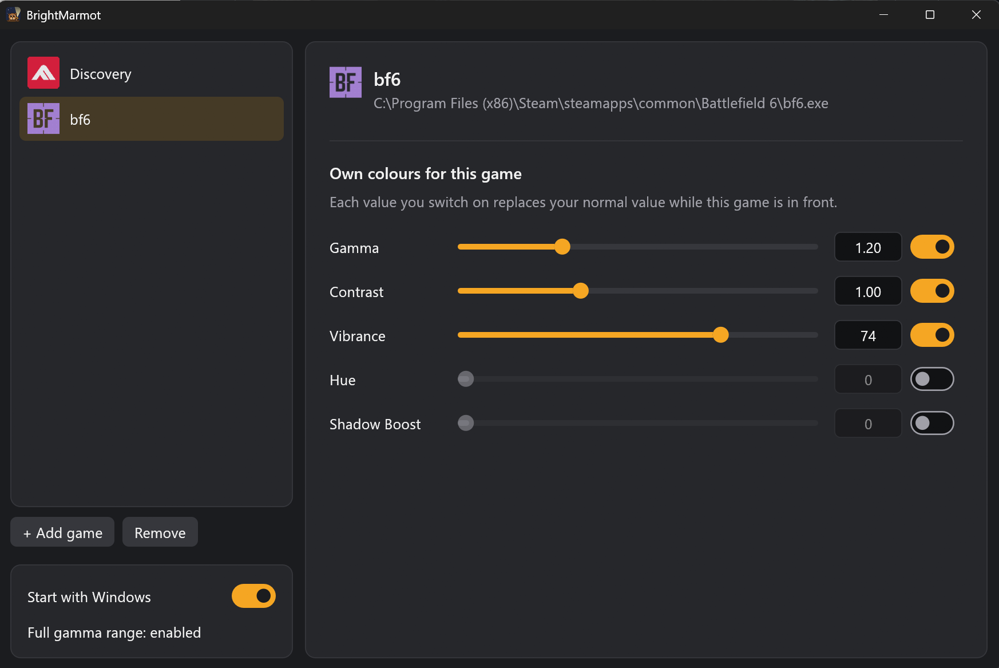

<p align="center">
  
</p>

<h1 align="center">BrightMarmot</h1>

<p align="center"><b>See enemies in the dark. Per-game brightness and colour, switched automatically when you Alt-Tab.</b></p>

BrightMarmot is a tiny Windows tray app that gives each of your games its own screen
colours. Set a game up once, brighter, punchier or more vivid, and every time that game
is in front, your monitor switches to those colours. Alt-Tab out or close the game and
your normal desktop colours come straight back.

No hotkeys to remember, no game files touched, nothing to babysit.

<p align="center">
  
</p>

## Why BrightMarmot?

- **Set it and forget it.** Colours switch on their own when the game comes to the front, and switch back when it doesn't.
- **Safe with anti-cheat.** It only changes your display settings, the same way the NVIDIA Control Panel or your monitor's buttons do. It never touches the game.
- **No performance impact.** It sleeps until Windows says the window in front changed. That means about **4 MB of memory** and 0% CPU while you play.
- **Works with HDR** on or off.
- **One small exe.** No installer, no account, no internet connection.

## Features

- **Per-game colour profiles:** Gamma, Contrast, Vibrance, Hue and Shadow Boost, each with its own on/off switch. Anything you leave off stays at your normal setting.
- **Automatic switching** on Alt-Tab, when the game starts, and when it closes.
- **Only the game's monitor changes.** Your other screens are left alone.
- **Add games the easy way:** pick from the apps that are running right now, or browse to the game's `.exe`.
- **Your normal colours are always restored.** Even if the app crashes or the PC loses power, they come back the next time it starts.
- **Start with Windows**, if you want it.

## Getting started

1. Download `brightmarmot.exe` from the [latest release](../../releases/latest) and put it somewhere permanent, for example `%LOCALAPPDATA%\Programs\BrightMarmot\`.
2. Run it. A marmot icon appears in your system tray. It may be hidden under the `^` arrow.
3. **Double-click the marmot** to open Settings.
4. Click **+ Add game** and pick your game from the list, or use **Pick .exe from disk…**.
5. Switch on the controls you want and drag the sliders.
6. Alt-Tab into your game. That's it.

> **First launch:** Windows normally limits how far apps can change gamma. BrightMarmot asks once whether to lift that limit. Say **Yes**, approve the admin prompt, and restart Windows once. If you say No it still works, but strong gamma settings may be capped.

## The controls

| Control | What it does | Range |
|---|---|---|
| **Gamma** | Brightens the mid-tones. The main "see in the dark" slider. | 0.50 – 3.00 (normal 1.00) |
| **Contrast** | Makes darks darker and lights lighter, or flattens them. | 0.50 – 2.00 (normal 1.00) |
| **Vibrance** | Makes colours pop (NVIDIA digital vibrance). | 0 – 100 (normal 50) |
| **Hue** | Shifts all colours around the colour wheel. | 0 – 359° (normal 0) |
| **Shadow Boost** | Lifts the darkest shadows without washing out the rest of the picture. | 0 – 100 (normal 0) |

Settings save automatically. Right-click the tray icon for **Settings** and **Exit**.

## Anti-cheat

BrightMarmot does **not**:

- modify game files, or read or write game memory
- inject anything into a game, or hook into it
- send keystrokes, mouse clicks or any other input to a game
- use keyboard or mouse hooks

It only uses standard display features: the Windows gamma ramp (the same thing your
monitor calibration uses) and NVIDIA's display colour settings (the same ones the
NVIDIA Control Panel changes). To notice which game is in front, it asks Windows for the
name of the foreground app, which any taskbar or overlay tool does too.

## Requirements

- Windows 10 or 11 (64-bit)
- **Vibrance and Hue need an NVIDIA GPU.** Gamma, Contrast and Shadow Boost work on any GPU.

## FAQ

**Does it work with any game?**
Yes. It changes your display, not the game.

**Will I get banned?**
BrightMarmot never interacts with the game itself. See [Anti-cheat](#anti-cheat) for exactly what it does and doesn't do.

**Will it slow my game down?**
No. It does nothing until the window in front changes, then applies the colours in a split second. It uses about 4 MB of memory.

**My antivirus or SmartScreen warns about it.**
The exe isn't code-signed, so Windows may say it's from an unknown publisher. Choose **More info → Run anyway**.

**The colours went back to normal in the middle of a game.**
A few fullscreen games reset the screen gamma themselves. BrightMarmot re-applies once right after you switch in. Alt-Tabbing out and back in also re-applies.

**Vibrance and Hue are greyed out.**
Those two use NVIDIA's driver. They're greyed out when no NVIDIA GPU drives the screen, or if a driver update stops them working.

**Does it fight with f.lux or Night Light?**
They change the same screen settings, so they may interact while a game is in front. Your normal colours, including theirs, are put back when you leave the game.

## Uninstall

1. In Settings, turn off **Start with Windows**, then right-click the tray icon and choose **Exit**.
2. Delete `brightmarmot.exe` and the folders `%APPDATA%\BrightMarmot` and `%LOCALAPPDATA%\BrightMarmot`.
3. Optional: remove the gamma-range setting. Delete the `GdiIcmGammaRange` value under `HKLM\SOFTWARE\Microsoft\Windows NT\CurrentVersion\ICM`.

<details>
<summary><b>Building from source</b></summary>

BrightMarmot is written in Rust and cross-compiled from WSL (Ubuntu) to Windows, so no Visual Studio is needed.

```sh
curl --proto '=https' --tlsv1.2 -sSf https://sh.rustup.rs | sh
rustup target add x86_64-pc-windows-gnu
sudo apt install mingw-w64
cargo test                 # logic tests run on Linux
scripts/install.sh         # builds a release exe and copies it to %LOCALAPPDATA%\Programs\BrightMarmot
```

`install.sh` refuses to run while BrightMarmot is running, so exit it from the tray first.

The icon's source is `assets/icon.svg`. After editing it, run `scripts/make-icon.sh` to regenerate the `.ico` and `.png` files (this needs `cargo install resvg`).

</details>
